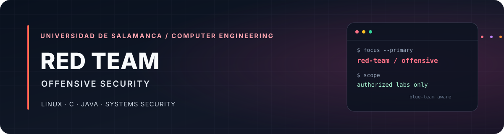

## Hi there 👋

<strong>Computer Engineering at USAL · Java & Vaadin · Cybersecurity</strong>

I´m Álvaro!
A final year computer engineering student at USAL (University of Salamanca). 
I’m finishing my degree and gaining professional software development experience with Java and Vaadin at Horus Hardware S.A. I’m building a career focus in cybersecurity, currently deepening expertise in penetration testing, adversary emulation, and threat detection. Familiar with tools across the full attack/defend lifecycle, aligned with the MITRE ATT&CK framework, OSINT, etc.

- 🌱 I’m currently learning Python, Typescript, Next.js and React.js to develop my Final year project.
- 🤔 I’m looking for help with ethical hacking, penetration, and to make secure applications.
- 💬 Ask me about anything about data structures, or wathever related to computer science things.

Security direction

| Primary focus | Complementary foundation |
| --- | --- |
| Red Team and offensive security | Blue Team and defensive awareness |

I’m building my foundations through authorized security labs and study of penetration-testing methodology, adversary emulation, and MITRE ATT&CK. I only test systems I own or have explicit permission to assess.

## Technical foundation

- **Systems and security:** Linux system administration, computer systems security
- **Programming:** Java, C, C#, Swift
- **Computer science:** data structures
- **Additional coursework:** video game development
- **Ways of working:** analytical thinking, communication, teamwork, agile methods, project management

## Technologies & Skills

**Focus:** Cybersecurity, with a primary interest in Red Team and complementary Blue Team foundations.

**Languages:** `C` · `C++` · `C#` · `Java` · `Python` · `JavaScript` · `TypeScript` · `SQL` · `MATLAB` · `Bash/Shell` · `Assembly` · `Lisp` · `Prolog` · `CLIPS` · `Swift`

**Web & application development:** `HTML` · `CSS` · `.NET` · `WPF` · `XAML` · `React` · `Next.js` · `Vaadin` · `Flask`

**Game development & graphics:** `Unity` · `Unreal Engine` · `OpenGL` · `GLUT` · `GLU`

**Systems, networking & security:** `Linux` · `VMware` · `VirtualBox` · `Cisco Packet Tracer` · `GNS3` · `OpenSSL` · `GPG` · `Git` · `GitLab CI` · `Docker`

**Current project setup:** `Cloudflare Workers` · `OpenNext` · `Wrangler`

**Core topics:** Data structures and algorithms · Linux system administration · Computer systems security · DNS · RIP/OSPF · TCP/UDP sockets

## 🧰 Technologies by context

Skills are grouped by where I’ve used or studied them; each project repository will show the scope and my contribution.

| Track | Technologies |
| --- | --- |
| 🟩 **Professional experience** | `Java` · `Vaadin` |
| 🟦 **Academic and personal projects** | `C` · `C++` · `C#` · `Python` · `JavaScript` · `SQL` · `MATLAB` · `Bash / Shell` · `Assembly` · `Lisp` · `Prolog` · `CLIPS` |
| 🟪 **Web and frontend** | `HTML` · `CSS` · `TypeScript` · `React` · `Next.js` |
| 🟧 **Desktop, games, and graphics** | `.NET` · `WPF` · `XAML` · `Unity` · `Unreal Engine` · `OpenGL` · `GLUT / GLU` |
| 🟦 **Systems, networking, and security** | `Linux` · `VMware` · `VirtualBox` · `Cisco Packet Tracer` · `GNS3` · `OpenSSL` · `GPG` · `Git` · `GitLab CI` |
| 🟨 **Project deployment** | `Cloudflare Workers` · `OpenNext` · `Wrangler` |
| 🟫 **Additional skill listed on my profile** | `Swift` |

**Computer science foundations:** data structures and algorithms, A* search, client-server sockets, relational database design, DNS, RIP, and OSPF.

**Ways of working:** analytical thinking, communication, teamwork, agile methods, and project management.

## 🟨 Currently learning

`Python` · `TypeScript` · `React` · `Next.js`

**Ways of working:** Analytical thinking · Agile methods · Teamwork · Communication · Project planning

Percentages are editable self-assessments, not certifications or formal test results. TypeScript, React and Next.js are current learning areas; Java and Vaadin also reflect professional experience.
## Currently learning

`Python` · `TypeScript` · `React` · `Next.js`

## Languages

- Spanish
- English — upper-intermediate

